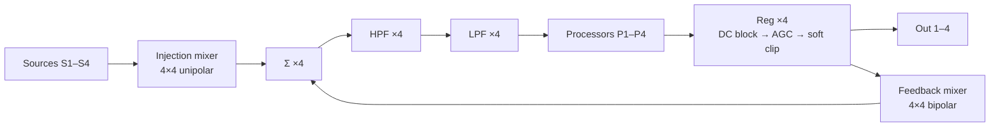

# 4x4 Feedback System

A patchable feedback network of four signal processors built around two 4×4 matrix mixers: an **injection mixer** that feeds external sources into the network, and a **feedback mixer** that routes every processor output back to every processor input.

---

## 1. Overview

| Part | Count | Role |
|---|---|---|
| Sources (S1–S4) | 4 | External signals injected into the network |
| Injection mixer | 1 × 4×4 | Four independent mixes of the four sources, one per channel |
| Feedback mixer | 1 × 4×4 | Every processor output to every processor input, bipolar |
| Summing points (Σ) | 4 | Combine the injection mix and feedback mix per channel |
| HPF + LPF | 4 + 4 | Clamp the frequency range entering each processor |
| Processors (P1–P4) | 4 | Strongly nonlinear in frequency and amplitude |
| Regulators (Reg) | 4 | DC block → AGC → soft clip on each processor output |
| Output taps (Out 1–4) | 4 | Regulated processor outputs to mixer or recorder |

## 2. Signal flow

```
S1..S4 ──► [Injection mixer 4×4, unipolar] ──┐
                                             ├──► Σn ──► HPF ──► LPF ──► Pn ──► Reg ──┬──► Out n
P1..P4 ─► [Feedback mixer 4×4, bipolar] ─────┘                                        │
   ▲                                                                                  │
   └──────────────────────────────────────────────────────────────────────────────────┘
```

Per channel n (1–4):

1. **Σn** sums injection-mixer output n and feedback-mixer output n.
2. **HPF → LPF** band-limit the signal before the processor.
3. **Pn** processes the signal.
4. **Reg** keeps the output level bounded and removes DC.
5. The regulated output is **split**: one copy to **Out n**, one copy to **column n of the feedback mixer**.



## 3. Matrix mixers

Both mixers read the same way: **columns are inputs, rows are outputs**. Each row goes to one channel's Σ.

### 3.1 Injection mixer (unipolar)

Pots range from **0 to +1**. No inversion is needed because the sources are not part of any loop.

| To ↓ / From → | S1 | S2 | S3 | S4 |
|---|---|---|---|---|
| **Σ1 (→ P1)** | + | + | + | + |
| **Σ2 (→ P2)** | + | + | + | + |
| **Σ3 (→ P3)** | + | + | + | + |
| **Σ4 (→ P4)** | + | + | + | + |

### 3.2 Feedback mixer (bipolar attenuverters)

Pots range from **−1 through 0 to +1**. Positive settings give positive (reinforcing) feedback, negative settings give negative (inverting) feedback. Center detents are strongly recommended.

| To ↓ / From → | P1 out | P2 out | P3 out | P4 out |
|---|---|---|---|---|
| **Σ1 (→ P1)** | ± self | ± | ± | ± |
| **Σ2 (→ P2)** | ± | ± self | ± | ± |
| **Σ3 (→ P3)** | ± | ± | ± self | ± |
| **Σ4 (→ P4)** | ± | ± | ± | ± self |

The diagonal is self-feedback. Everything else is cross-feedback.

## 4. Feedback coverage

The single 4×4 feedback mixer covers every possible connection between the four processors: 16 crosspoints for 16 possible output-to-input connections. It therefore covers all loops and all combinations of them.

| Loop type | Count |
|---|---|
| Self-loops (Pn → Pn) | 4 |
| Two-processor loops | 6 |
| Three-processor loops (both directions) | 8 |
| Four-processor loops | 6 |
| **Total elementary loops** | **24** |

- **Topologies:** 2¹⁶ = 65,536 on/off combinations of the 16 crosspoints, each with continuous bipolar gain.
- **Loop sign:** a loop's overall sign is the product of the pot signs along it, so mixing signs across a loop gives anything between reinforcing and cancelling.

Cascading two matrices would not add routings (M2 × M1 is still a 4×4 matrix). That is why the second mixer is used for injection instead.

## 5. Channel strip

### 5.1 Σ, the summing point

Sums the injection mix and the feedback mix for that channel. Options:

- the processor's second audio input or mix input
- a small 4-channel mixer
- an attenuverted processor input, which gives a per-channel injection/feedback balance

### 5.2 HPF and LPF, the band clamp

These filters set the frequency range each processor works on and keep loops from building up energy outside it.

- Ideally CV-controllable cutoffs. Sweeping a loop's band limits is a very expressive performance control.

### 5.3 Processors

These are strongly nonlinear in both frequency (resonances) and amplitude (level-dependent gain). As a result, loop gain is not constant, and no fixed pot setting is guaranteed safe.

### 5.4 Reg, the regulator

This is the clipping-safety stage, one per processor output. It sits before the split, so every loop passes through at least one regulator and the output taps are protected too.

| Stage | Purpose | Starting settings |
|---|---|---|
| DC block | Stops DC and sub-audio runaway that eats headroom | HPF around 10–20 Hz |
| AGC (leveler) | Drives effective loop gain to 1 at a target level, giving sustained sound without runaway | RMS or peak detector on the full band; attack about 2–10 ms; release about 100–500 ms; target well below clipping; ≥ 30 dB of available gain reduction |
| Soft clip (tanh) | Hard ceiling for transients faster than the AGC | Never hard clip, because hard clipping adds harmonics the loops can re-amplify |

**Why an AGC rather than a clipper alone:** a clipper bounds the level, but the loop then sits pinned in saturation. An AGC lets the loop settle at a controlled amplitude, the same principle as the lamp in a Wien-bridge oscillator.

## 6. Output taps

Each regulated output is split, using a mult or a module with two output jacks:

- **Out n:** to a mixer or recorder
- **Feedback mixer column n:** back into the network

## 7. Playing notes

- **Start** with all feedback pots at 0. Inject a source, then open one self-loop at a time.
- **Negative self-feedback** tends to tame resonances and thin the sound. **Positive self-feedback** reinforces them.
- **Small offsets** from zero on the bipolar pots can start a loop singing, which is why center detents matter.
- **A near-silent source** is still useful: some injection is needed to kick-start loops, but once they sustain, the network can run on its own.

## 8. Open items and possible extensions

- [ ] Choose the summing method per channel (processor second input, mini mixer, or attenuverted input).
- [ ] Choose the regulator implementation: a custom digital 4-channel DC-block/AGC/soft-clip algorithm, or analog levelers plus a saturator.
- [ ] **Multiband AGC (2–3 bands):** prevents one resonant peak from ducking the whole spectrum.
- [ ] **Global energy governor:** a VCA on all four feedback-mixer outputs, driven by the summed level of all processors, with a slower release than the per-channel AGCs. It sets an overall energy budget and reduces pumping between regulators.
- [ ] CV control of the HPF/LPF cutoffs.
